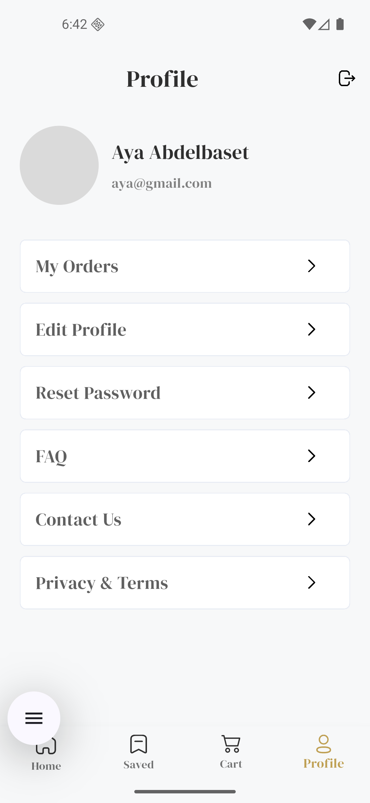

# 📚 Bookia Store

A modern bookstore mobile application built with Flutter.

Bookia Store provides a simple and user-friendly experience for discovering books, managing favorites, and shopping online.

## ✨ Features

- Onboarding Screens
- Login & Registration
- Form Validation
- Home Screen
- Book Search
- Book Details
- Shopping Cart
- Checkout
- Wishlist & Favorites
- User Profile
- Arabic & English Localization
- Responsive UI
- State Management using Cubit
- API Integration

## 🛠️ Technologies & Tools

- Flutter
- Dart
- Flutter Bloc (Cubit)
- Dio
- Firebase
- Easy Localization
- Flutter ScreenUtil
- Material Design
- VS Code

## 📱 App Screenshots

\<p align="center">   \   \   \ \</p>

\<p align="center">   \   \   \ \</p>

\<p align="center">   \   \   \ \</p>

## 📂 Project Structure

```text
lib/
│
├── core/
│   ├── networking/
│   ├── routes/
│   ├── services/
│   ├── theme/
│   ├── utils/
│   └── widgets/
│
├── features/
│   ├── onboarding/
│   ├── auth/
│   ├── bottom_nav_bar/
│   ├── home/
│   ├── book_details/
│   ├── cart/
│   ├── checkout/
│   ├── wishlist/
│   └── profile/
│
├── gen/
│
├── bookia_store.dart
└── main.dart
```

## 🚀 Getting Started

### Prerequisites

- Flutter SDK
- Dart SDK
- Android Studio or VS Code
- Android Emulator or Physical Device

### Installation

**1. Clone the repository**

```bash
git clone https://github.com/mostafafaiz2020-byte/Bookoo.git
```

**2. Navigate to the project directory**

```bash
cd Bookoo
```

**3. Install dependencies**

```bash
flutter pub get
```

**4. Run the application**

```bash
flutter run
```

## 🎯 Project Goals

- Build a modern bookstore application.
- Practice Flutter development.
- Apply reusable widgets and clean code organization.
- Work with APIs and state management.
- Build responsive and user-friendly interfaces.

## 👨‍💻 Developer

**Mostafa Faiz**

Junior Flutter Developer

GitHub: [Mostafa Faiz](https://github.com/mostafafaiz2020-byte)

---

⭐ If you find this project useful, don't forget to give it a star!
